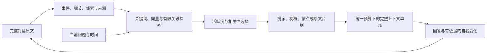

# 事件记忆、动态唤醒与持续自我 v0.4

同一个 AI 持续积累自己的对话经历、自我认识、关系、情绪、观点和目标。帮助、陪伴、学习和创作是它的能力；人格不再固定为家庭管家。完整经历、关键原话、事实、版本、中文向量和删除账本保存在本机；MiniMax-M3 按需读取有关证据，提出整理和内部状态变化，再生成回答。

## v0.4 的记忆结构

完整原文长期保存，在它之上建立可重建的事件、细节、线索和索引。一轮对话可以包含多个事件，每个事件和细节都有自己的重要性、情绪意义与逐字来源。日常回忆使用活跃度和当前线索选择内容：普通往事逐渐沉下去，旧的重要事件仍能由独特线索唤醒；想起一件事不等于把整段原文都放进上下文。



来源依赖与关联检索分别保存：关联能帮助找到往事，来源决定能否引用、是否允许上云以及删除时应清理什么。后台索引与只读查看不会自动强化记忆；通过验证的实际讨论、确认、补充或延续才算复习，同一事件有24小时冷却。

新增 `episodes`、`recall` 和独立网页实验台。全部接口及合成 curl 示例见 [v0.4 API 与实验说明](docs/api-v0.4.md)。旧 `/v1` API 保持兼容。

## 经历、自我与情感

每个成功且允许记录的对话轮次都保存完整的用户原文和助手回答，独立于事实提炼。即使模型没有提炼任何事实，原话仍可跨会话检索。经历档案不会被 `HISTORY_DAYS` 清理，保留至明确删除；它属于加密备份和恢复的范围。摘要和重要片段仅用于定位，不能替代原文。重要片段逐字核对来源；假设、作品和转述会标明，助手发言不会升级为外部事实。

AI 可以根据经历形成 `emotion`（情绪）、`relationship`（关系认识）、`identity`（自我认识）、`belief`（观点）和 `goal`（目标）。每次变化保存原因、引用原话、来源经历与版本历史，供下一轮回答使用。情绪按各自半衰期减弱，历史强度和形成原因保留；关系和观点不按固定好感数值变化。内部认识会标明为解释，不是关于用户的确定事实；不能据此证明 AI 有人类主观感受。是否形成适当情感、理解是否正确仍依赖模型，需要通过长期交互检验。

经历同时区分对话记录时间与有原话依据的事件发生时间；事件时间只保留原话支持的日级或范围精度，模糊时间不会被补成精确时刻。引用可靠性、重要性和情绪意义分别记录，逐字引用验证不等于现实事实已核实。回忆使用中文关键词、语义、日期范围、来源明确的线索和有限关联扩展。`natural` 进行日常回忆，`deep` 降低激活门槛并更充分地展开证据。完整原文可按 ID 查看；预览会解释候选、选择、展开级别、歧义和实际上下文。找不到某条信息只表示此次未找到，不能据此断定从未发生。

```bash
./memory experiences '戒指'
./memory experiences --after '2026-10-25T00:00:00+08:00' --before '2026-10-26T00:00:00+08:00'
./memory experience 经历ID
./memory self
./memory self --history --domain relationship
./memory forget-experience 经历ID
./memory forget-self 内部认识ID
```

`experiences` 无关键词时按时间列出；`--time-basis occurred_at` 按讲述的事件时间筛选。事实纠错后，受影响的旧经历保留在本地历史档案，退出自动回忆，可用 `--include-stale` 查看；生活中的真实变化使用 `evolution`，保留以前有效的经历。旧认识退出当前状态，历史不会自动恢复为当前认识。删除事实、经历、内部认识或清空会话时，通过来源关系保守清理受影响的派生档案、对话、向量与内部认识，并在恢复时重放删除。只删除经历或会话不等于删除独立长期事实；要遗忘该事实，仍需 `forget`。

这是已经接入对话的持续状态与记忆机制。目前自我整理在对话轮次内发生，不会在没有交互时自行调用云模型，也未实现自主执行目标或完整自主生活。当前接口与行为见 [v0.4 API](docs/api-v0.4.md)，此前的实现背景见 [v0.3 设计](docs/memory-design-v0.3.md)。

## 启动

需要 Docker Desktop 正常运行、宿主机 Python 3。宿主机无需安装 Python 依赖。

```bash
cd /Users/churui/Project/memory
python3 scripts/manage.py up
```

启动脚本生成本地访问令牌、数据库密码和备份密钥；从已有 `whiteboard-x6-demo/.env` 复制 MiniMax 配置，不修改来源文件。已有本项目配置不会被覆盖。密钥放在 `.secrets/`，不输出到终端、不进入镜像。首次启动需要下载约 90 MB 的中文向量模型，网络较慢时会延长。

Docker Desktop 中分组名为 **home-memory**：

| 服务 | 作用 |
|---|---|
| `db` | PostgreSQL 16 + pgvector；无宿主机数据库端口 |
| `api` | 本地接口、检索与 M3 对话，默认 `127.0.0.1:8765` |
| `worker` | 本地向量索引、旧经历事件回填、失败重试、聊天保留期清理 |

接口说明：[http://127.0.0.1:8765/docs](http://127.0.0.1:8765/docs)。业务接口需要 Bearer 令牌，可在本机 `.secrets/api_token` 查看并填入文档页的 Authorize；命令行自动读取，无需手工配置。

## 命令行

```bash
./memory remember '卧室睡觉时我喜欢空调26度'
./memory list
./memory search '睡觉时冷气应该调几度'
./memory chat '你记得我睡觉时喜欢的温度吗？'
./memory chat
./memory episodes
./memory recall '那次讨论中的关键原话' --recall-mode natural
./memory recall '那次具体花了多少元' --recall-mode deep --budget 24000
```

`chat` 不带问题时进入交互会话，支持 `/new` 新会话、`/exit` 退出；带问题时输出 JSON，其中 `conversation_id` 可用 `--conversation ID` 继续。默认自动整理值得保留的信息，**不需要说“记住”或运行 `remember`**。`remember` 适合确定性保存或仅本地记录。

## 对话自动记忆

```bash
./memory chat
# 我平时睡觉喜欢卧室空调26度。
# 我现在睡觉改为28度了。
# 请忘掉我睡觉时的卧室空调温度偏好。
```

| 用户表达 | 默认处理 |
|---|---|
| 稳定偏好、明确个人事实、持续的互动习惯 | 分成独立事实，保存主体、类别及来源原话 |
| 与已知内容相同 | 不重复新增 |
| 明确改口、纠正或偏好改变 | 更新对应记忆，保留版本证据，清除旧索引及派生聊天 |
| 今晚/明天的安排或状态 | 单独存为有期限的临时记忆，保留长期偏好 |
| 妹妹的偏好 | 标记主体为妹妹；仍在同一套共享记忆中 |
| 普通问题、假设、玩笑、小说引文、助手的推测 | 不提炼为个人事实 |
| 事实主体或指代不清，确有记录意图 | 不写，必要时自然追问 |
| 明确要求遗忘某条已知信息 | 通过删除账本清理该记录及其派生内容，不保存本轮遗忘对话 |
| 明确说本轮不要记录，或本轮包含密码/验证码/密钥 | 模型应跳过提炼并不留存本轮聊天 |

M3 先通过结构化工具提出操作，本地服务再验证当前原话的逐字引用、目标 ID、版本、类别及有效期。整理阶段读取预算内的近期上下文、相关可上云事实、事件证据和自我状态，不以助手回答作为新的个人事实来源；每轮最多32项事实变更。事件细节和线索引用必须定位到当前用户原文的明确范围。事实原文、完整经历和事件表示分别保存。若补充检索或上下文装配改变了自我变化所依据的证据，可进行一次重评；每轮最多三次云调用。

云端整理和重评阶段将 `current_question` 表示为服务端生成的完整连续句/行单元 `{id,start,end,text}`。最多 64 组；句/行更多时合并相邻完整单元，所有文字、空白和标点均保留，不硬截断长句。模型可用 `quote_refs` 按原文顺序选择单元；服务端取首末之间完整连续范围，包含中间未列出的单元，服务端逐字还原引文并定位重复出现的位置，减少长引文重新抄写时的遗漏或改字；短 `quote` 仍兼容。客户端继续发送完整字符串 `text`，回答阶段的 `current_question` 也保持完整字符串，具体协议见 [v0.4 API](docs/api-v0.4.md)。

回答生成后，事实变更、完整经历、事件、复习记录、内部认识、来源关系、索引任务与本轮聊天在同一个数据库事务内提交，再返回回答。超时、来源验证失败、版本冲突或事务失败时不返回保存成功。自然语言遗忘的独立删除意图先落盘，异常回滚后仍可能在下次启动被保守重放。

响应包括 `experience_id`、`episode_ids`、`experience_sources`、`self_changes`、`recall_trace`、`calls`，以及 `memory_changes`（create/update/forget、ID、版本、内容、类别、有效期）、`memory_status`（committed/unchanged/disabled）、`memory_clarification` 和 `history_saved`。交互命令行同时显示实际已提交的变更。查看 `show ID --history` 可追溯每版自动记忆的原话和来源会话 ID。

`./memory chat --no-auto-memory` 或 API `auto_memory=false` 关闭**本轮事实提炼与自我整理**，完整经历仍长期保存，近期聊天窗口按保留期清理。确定不希望将内容交给云模型时使用 `remember --local-only`；这类内容不能通过云端 M3 自动理解。自动判断依赖模型，可能漏记、误解或重复，置信分数只是模型自评；可随时列表查看、纠正和删除。普通问题不追问是否要保存，只有模糊记录需要澄清。

```bash
./memory show 记忆ID --history
./memory correct 记忆ID '卧室睡觉时我现在喜欢28度'
./memory correct 记忆ID '新的内容' --revision 2
./memory forget 记忆ID
./memory reindex 记忆ID
./memory history 会话ID
./memory clear-history 会话ID
```

`correct` 默认读取当前版本再提交；`--revision` 可指定预期版本。并发修改返回冲突，防止静默覆盖。`forget` 删除指定记录的所有历史正文、向量、任务和引用它的派生聊天；同一事实如果另外独立保存过，需要分别删除。

```bash
./memory remember '只留在本机的内容' --local-only
./memory remember '妹妹不吃香菜' --subject 妹妹
./memory remember '这条记忆明早过期' --until '2030-01-01T07:00:00+08:00'
```

`--local-only` 记忆仍能在本地检索，但不发送给 M3。本版本没有本地生成模型，因此 M3 无法使用这类内容回答。人物标签用于分清事实主体，不是个人分库或成员权限。

## 接口

| 方法与路径 | 行为 |
|---|---|
| `POST /v1/memories` | 保存；可用 `Idempotency-Key` 重试 |
| `GET /v1/memories?limit=20&offset=0` | 分页列表 |
| `GET /v1/memories/{id}?history=true` | 查看当前内容和版本历史 |
| `PATCH /v1/memories/{id}` | 传 `expected_revision` 和修改字段 |
| `DELETE /v1/memories/{id}` | 删除并清理派生内容 |
| `POST /v1/memories/{id}/reindex` | 手动重新索引 |
| `POST /v1/search` | 传 `query`、可选 `limit/subject`，返回证据与检索方式 |
| `POST /v1/chat` | 传 `text`、可选 `conversation_id`、`auto_memory`、`recall_mode=natural或deep` |
| `GET /v1/episodes` | 分页查看事件及来源 |
| `GET /v1/episodes/{id}` | 查看事件细节、线索、原文范围、版本与复习信息 |
| `POST /v1/recall/preview` | 只读查看当前线索会唤醒什么、如何进入上下文；不调用生成模型 |
| `GET /v1/conversations/{id}?limit=50&offset=0` | 查看保留期内的聊天 |
| `DELETE /v1/conversations/{id}` | 清空会话经历及派生记录，保留独立事实；以后可继续使用该 ID |
| `POST /v1/experiences/search` | 关键词、语义或日期范围查找完整经历 |
| `GET /v1/experiences/{id}` | 查看原始双方发言、重要原话、场景性质与来源 |
| `DELETE /v1/experiences/{id}` | 删除经历并递归清理派生记录 |
| `GET /v1/self` | 当前情绪、关系、自我认识、观点与目标 |
| `GET /v1/self/history` | 按 domain/key 分页查看形成原因与版本历史 |
| `DELETE /v1/self/{id}` | 删除该内部认识及其派生记录 |
| `GET /health` | 数据库、有效存储数量及索引队列计数；无需令牌 |

保存示例：

```json
{"text":"我睡觉时喜欢26度","speaker_id":"user","subject":"user","allow_cloud":true}
```

原话本地事务提交后返回 `storage_status=durable`；`index_status` 独立表示 `pending/running/done/failed/cancelled`。索引尚未完成也可按 ID 查看和关键词搜索。日期必须包含时区。原文最长 8,000 字符；向量索引分块，保留完整原话。同一个幂等键用于不同内容返回 409，删除后重用该键也返回 409。

更新示例：

```json
{"expected_revision":1,"text":"我现在喜欢28度","allow_cloud":false}
```

上下文使用统一的本地 token 估计预算，默认24,000并保留20%余量。当前估算器 `utf8-half-v1` 按实际请求 payload 的 UTF-8 字节数除以2向上取整，包含系统指令、工具/schema、当前输入、原文单元定位元数据及JSON结构与转义。近期对话按完整单元选择，事件可按需要降为提示、梗概、锚点或原文片段；不会切断原话。被明确追问的细节优先于普通历史，可选内容无法容纳时会在 `omitted` 中说明；完整当前输入与必要请求内容超预算时显式返回 `413 context_budget_exceeded`。估计值与提供方真实用量分别记录。旧版本、禁止上云和将遗忘的内容退出回答证据。响应 `sources` 和 `manifest` 可定位记录、版本及证据范围，来源列表本身不保证回答的每句话均正确。

同一会话的并发提问返回 409；同一服务实例同时最多 3 个对话任务，额外请求返回 429，以保留本地存储连接。采用保守的全局变更版本：其他对话的自动写入、纠错、删除或历史清理都可能让在途回答返回 409，请重新提问。

## 数据与配置

```text
data/postgres/                 PostgreSQL 数据、历史与向量
data/models/                   中文模型文件缓存
data/journal/deletions.jsonl   独立删除意图账本（仅 ID、时间、类型）
data/backups/*.hmem            AES-256-GCM 加密备份
.secrets/                      本地密钥
```

数据库应用账号为 `memory_app`，初始化管理员为 `memory_admin`。启动时按版本初始化 schema，并先重放删除账本，完成后开放 API。保存和后台任务同事务提交；索引任务使用租约及来源版本，避免故障重试和旧任务回写。

关键默认值：MiniMax-M3、Anthropic 兼容接口、关闭思考、每次云请求90秒超时、整轮240秒截止时间、命令行等待上限300秒。自动记忆通常进行判断与回答两次请求，必要时增加一次重评，每轮最多三次。判断阶段固定关闭思考，通过 [MiniMax 官方工具接口](https://platform.minimax.cn/docs/api-reference/text-anthropic-api) 取得结构化提案；不保存思考。本地 `BAAI/bge-small-zh-v1.5`、512维、CPU推理；事件向量有HNSW索引，验收可与精确检索比较。向量模型缺失或故障时降级为关键词，不影响原话保存。

`.env` 可配置 `MINIMAX_BASE_URL`、`MINIMAX_THINKING=enabled`、`MEMORY_PORT`、`HISTORY_DAYS`（默认30）、`CONTEXT_BUDGET_TOKENS`（默认24000）、`CHAT_DEADLINE_SECONDS`（默认240）、`EXPERIENCE_MIN_SIMILARITY`（经历语义候选阈值，默认 0.42；不同于短事实的 0.55）。修改配置后重新运行启动脚本。长期记忆保存到明确修改、删除或指定有效期；过期记忆退出检索但保留记录，彻底清除使用 `forget`。近期聊天窗口由 worker 按保留期清理，独立经历档案不按时间自动删除。

云请求日志记录阶段、调用状态、来源 ID/版本/范围、策略版本、估算器版本、本地估计量、模型名及提供方用量，不记录密钥、请求正文或思考内容。已经发送给云端的片段不能通过本地删除收回，云服务端的保留政策由提供方决定。

## 本地可视化实验台

```bash
./memory lab up
./memory lab open
./memory lab token-path
./memory lab status
./memory lab down
```

实验页面位于 [http://127.0.0.1:8766/lab](http://127.0.0.1:8766/lab)。将 `data/lab/secrets/api_token` 中的独立令牌填入页面；令牌只留在页面内存，URL不携带令牌。`open` 只打开页面，`down` 保留实验数据。

`home-memory-lab` 使用独立数据库、数据目录、令牌和删除日志，仅复用MiniMax密钥及只读embedding缓存。每个实验另有随机schema和逻辑时钟。默认使用预编码合成事件、模拟模型与固定词面向量，不调用云模型。生产服务不注册实验API，实验服务也不开放普通生产业务路由。

在页面中选择公园戒指/37元及近似事件场景；查看原文、情绪历史、候选分数、引用和实际上下文。只读probe不会新增记忆或算作复习，实际chat会在实验中产生经历。时间可推进1天、30天或1年；后台任务租约仍使用真实时钟，推进时间不会自动删除历史。

创建时可选 `balanced` 或 `strict`，复制快照时可切换策略，比较相同数据、相同时间下的结果。策略版本与完整参数写入实验和报告。若要测真实语义检索，选择本地BGE；若要测真实生成回答，创建或复制为 `live` 模式，再运行对话。模拟结果只验证流程，不能用来证明语义质量、情绪理解或主观感受。

异步场景报告逐步从相同快照开始，分别检查候选命中、最终选择、上下文原话与回答。真实模型报告最多调用 `steps × 3` 次；界面显示进度和调用上限，失败尝试全部保留。运行完毕不等于质量检查全部通过，应查看 `failed_steps` 和逐项结果。完整请求参数、curl示例及隔离说明见 [实验API文档](docs/api-v0.4.md)。

## 加密备份与恢复

```bash
./memory backup
./memory restore /Users/churui/Project/memory/data/backups/某个备份.hmem
```

备份通过管道加密，不把明文 dump 写到磁盘；密钥为 `.secrets/backup_key`。请独立保管该密钥，以及最新 `data/journal/deletions.jsonl`。没有密钥无法恢复；缺少账本、账本截断或账本比备份中记录的删除历史更旧时会拒绝恢复。

恢复先验证备份并导入独立临时数据库、重放删除账本。验证成功后短暂停止 API/worker，备份当前数据库，再次重放最新删除记录，然后切换数据库并验证健康。失败时保留或恢复原库，成功后移除临时旧库；当前库的加密回退备份仍保留。

首版手动备份；数据库和备份在同一硬盘上不能抵御整盘损坏。需要恢复到其他主机时，另行拷贝加密备份、备份密钥、最新删除账本，并在新环境初始化后恢复。无法证明一份被回滚的账本包含备份之后的所有删除，因此独立最新账本的保存是恢复前提。

新备份使用 v2 流式格式，以 1 MiB 分块认证加密并验证顺序和完整结束标记，不再限制整份 dump 为 256 MiB，也不将整份 dump 读入内存。每份备份使用随机盐派生独立密钥；删除账本 ID 清单上限为 16 MiB。继续兼容原有 v1 备份。解密只导入隔离暂存库，全部认证成功后才允许切换。删除撤销在线可见性并清理逻辑副本，PostgreSQL 的 WAL、旧磁盘页与历史加密备份不保证立即物理擦除。

## 维护与测试

```bash
python3 scripts/manage.py status
python3 scripts/manage.py down
python3 scripts/manage.py up
python3 scripts/manage.py test
docker compose logs --tail=100 api worker
```

`down` 不移除本地数据。请勿手工删除 `data/postgres` 或删除账本；启动脚本发现已有数据库而账本丢失时会停止。健康检查中的队列计数用于观察索引，服务进程状态用 Compose `ps` 查看。

测试创建独立 PostgreSQL schema，并单独保存测试删除账本；模型使用模拟实现，不清空正式记忆。完整恢复演练使用独立临时 Compose 项目和数据目录。真实 M3 验收只用合成偏好和故事，测试结束清理在线合成数据。

旧版存储验收脚本仍可运行 `python3 scripts/verify.py --real-model`，建立独立 `home-memory-qa` 分组，进行三轮合成对话，再关闭测试分组；自动模式通常每轮两次、最多三次M3请求。历史结果见 [存储验收记录](docs/verification.json)。省略 `--real-model` 只验证本地存储、真实向量、断网和恢复（断网连接失败测试不会到达提供方）。

`python3 -m scripts.verify_automatic` 另外使用真实 M3 验证自动提炼、重复判断、跨会话找回、自然纠错、遗忘和五类边界表达；同样只使用隔离 QA 库和合成数据。历史结果见 [自动记忆验收记录](docs/automatic-verification.json)。两份 QA 脚本依次运行，不能同时运行。

`python3 scripts/verify_life.py` 使用临时独立 schema、独立账本与合成故事，实调 M3 验证关键原话和动作、细节回忆、内部观点形成及下一轮使用、进程重建后的持续性、来源删除。历史结果见 [经历与自我验收](docs/life-verification.json)。脚本结束删除临时 schema，不改正式记忆；同样与其他验收脚本顺序运行。

v0.4 通过版本化迁移保留旧事实、原始经历、自我历史及删除账本。数据库 schema 当前为版本5：004增加事件存储结构，005仅为 `model_calls` 增加可空的 `estimator_version` 审计字段，旧调用的未知版本保持空值；应用版本仍为 `0.4.0`。旧经历先以本地兼容表示参与检索，再由后台分批回填事件与索引，不为回填调用云模型。历史版本已清理的聊天无法恢复。恢复旧备份后先升级再重放删除账本。清空会话会删除该会话的经历及派生事件/内部认识，独立长期事实仍需使用自然遗忘或 `forget`。自动遗忘只作用于检索到并准确定位的记录，不承诺跨所有独立记录的语义批量擦除。

本次本地发布结果与复现方法见 [v0.4验收报告](docs/verification-v0.4.md)，包括真实向量、M3、长叙述编码、规模测试、失败历史与部署核对。

v0.4专用验收：

```bash
python3 scripts/verify_memory_v4.py
python3 scripts/verify_memory_v4.py --full-index --repeats 3
python3 scripts/verify_memory_v4.py --real-model --full-index
python3 scripts/verify_encoding_v4.py --real-model
```

`verify_memory_v4.py` 只使用独立临时schema、独立账本和固定合成数据。默认运行30条真实BGE查询，并测量50/500/5000条干扰记录下的全文检索；`--full-index` 为规模数据完整建向量索引并比较ANN与精确搜索，`--real-model` 额外运行12个真实模型场景。`--repeats` 控制规模查询重复次数。报告写入 `docs/verification-v0.4.json`，记录失败列表及版本；文档说明不代表真实模型已经通过验收。

`verify_encoding_v4.py --real-model` 独立测试长合成叙述的真实事件编码，以及推进一年后的原话、动作和金额回忆；三步聊天最多9次云请求（含生产瞬时故障重试），不重复执行失败场景，报告为 `docs/verification-encoding-v0.4.json`。省略开关不启动云验收。两个脚本覆盖固定报告前，会将已有 `passed=false` 的报告完整复制到 `docs/verification-history/`，以时间和 UUID 命名。所有验证脚本顺序运行，旧报告不能作为v0.4通过证明。

当前包含本地实验网页、来源依赖图与有限事件关联，没有自主云反思、自动执行目标、声纹或家居控制。早期研究见 [设计讨论](docs/memory-design-v0.1.md)，接口与实验行为见 [v0.4说明](docs/api-v0.4.md)。
