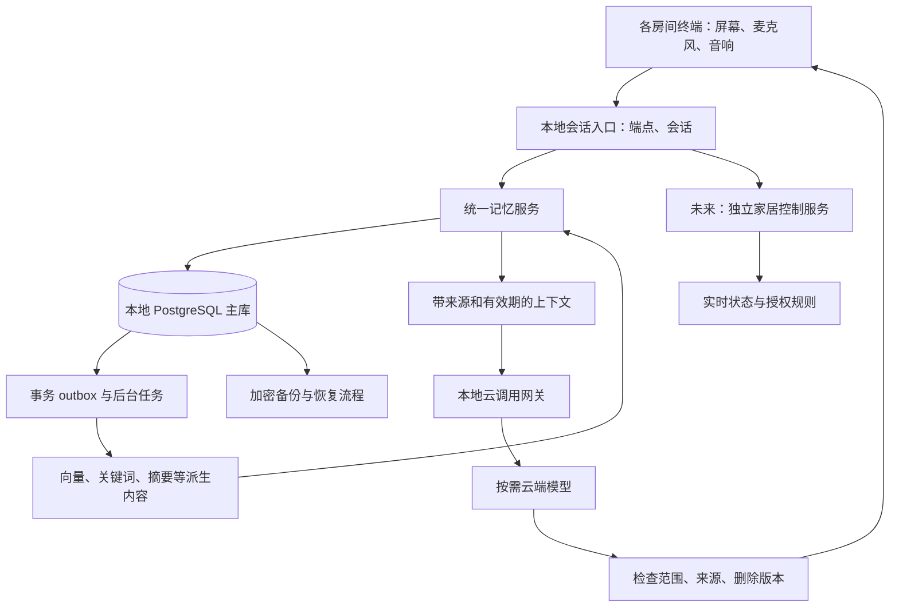

# 家庭 AI 记忆系统设计 v0.1（统一管家记忆）

日期：2026-10-23（Asia/Shanghai）  
状态：早期研究设计稿，保留供后续演进参考。实际 v0.1 已按批准的开发范围实现并部署，使用方式和当前能力以 [README](../README.md) 为准，验收见 [记录](verification.json)。  
配套材料：[三方评审与资料](./memory-review-2026-10-23.md)。

## 1. 决策与边界

采用 **本地 PostgreSQL + pgvector + 统一记忆服务**。整套记忆属于同一个家庭 AI，由自有服务管理原话、来源、涉及的人物、时间、纠错、删除与可靠回执；抽取、整理和复杂检索使用可替换组件。Hindsight 是第一个值得测试的候选适配器，是否启用取决于同条件中文家庭用例的结果；Mem0 是备选。

用户已确认：

- 记忆在本地保存，允许按需调用云端模型。
- 第一版只服务用户本人，不实现家庭成员账户、声纹识别、访客角色或多人记忆权限。
- 长期方向为同一位管家共享一套记忆；未来增加说话人识别，不按家庭成员拆分记忆空间。能说什么由 AI 结合人物、场景和明确嘱咐判断。
- 后续同一个 AI 通过全屋屏幕、音响交互，并接入家居控制。

本阶段只完成单人文字记忆闭环。换房间沿用统一服务的上下文与记忆，属于后续终端接入，不单列为记忆系统的核心攻关或发布门槛。全屋语音、形象渲染、多人说话识别与披露判断、真实家电执行在需要时另做。

数据不设置按成员隔离的 `owner_id` 或个人记忆空间。记录谁说的、说的是谁、谁参与了事件，用于理解和检索，而非建立成员读取权限。未来声纹识别只更新说话人及对话参与者信息，仍读取同一套记忆。

本方案的目标是可检验的持久化、可追溯更新和有依据的回忆。模型可以更换，记忆不随之清空。

## 2. 全屋如何共用记忆



各房间是同一个 AI 的交互入口。人格配置和记忆服务集中管理；房间终端不各自训练人格、保存独立长期档案。短时断网缓存也必须带稳定事件 ID，不能形成第二套权威记录。

记忆由同一个管家统一维护。位置、终端与会话在接入对应能力时分别用 `room_id`、`endpoint_id`、`conversation_id` 标识，说话人用 `speaker_id` 标识；这些是场景信息。换房间沿用同一服务的上下文和记忆，默认只向发起终端回答。

Home Assistant 的语音流水线和 satellites 可作为后续全屋语音接入基础，其唤醒、转写、对话和语音合成可以分别选择运行位置。[官方语音架构](https://contributors.home-assistant.io/architecture/platform/voice/)

## 3. 她需要保存哪些记忆

下表是逻辑分类，不要求每类部署一套数据库。

| 类别 | 示例 | 保存和使用方式 |
|---|---|---|
| 工作上下文 | 刚才讨论的电影、尚未回答的问题 | 短期会话状态，有过期时间；由统一服务维护 |
| 显式原话 | “记住，我希望你在我沉默时也陪着我” | 原文可独立保存和检索，不强行转成控制规则 |
| 事实与偏好 | 称呼、喜欢的音乐、睡眠温度 | 结构化、带条件和时间、支持版本与纠错 |
| 事件与共同经历 | 一起挑选电影、用户告诉她的旅行 | 保留人物、时间、结果、来源及她实际参与的方式 |
| 候选规律 | 多次调暗灯光，可能喜欢柔和照明 | 标记推断；不能冒充明确要求或触发自动控制 |
| 家庭知识与经验 | 房间别名、设备说明、一次控制失败 | 资料注明版本；经验保留实际结果；状态另查 |
| 核心身份与表达设定 | 她的名字、表达风格、用户认可的设定 | 受控版本配置；每轮只加载少量相关内容 |

人格初始设定、生活事实、系统授权分别管理。后台整理可以形成候选认识，不能自由修改身份、权限和用户明确配置。关于共同经历，要区别“用户告诉过我”“我参与了当时的对话”“系统实际观察到”，避免虚构亲历。

这一分层参考了 LangMem 的事实、经历、程序性记忆分类，以及 Hindsight 对事实、经历和归纳内容的区分；这里的具体边界属于本项目设计。[LangMem 概念](https://langchain-ai.github.io/langmem/concepts/conceptual_guide/)、[Hindsight 原论文](https://arxiv.org/abs/2512.12818)

## 4. 最重要的记忆规则

1. **保存与理解分别报告。** 没有本地提交成功，不说“记住了”。原文保存成功但解析未完成，回答“原话已保存，正在整理”。
2. **每条结论有来源。** 保存谁说的、说的是谁、发生于何时，以及自述、观察或推断。助手自己的复述不增加独立证据。
3. **临时要求有明确范围。** “今晚 28 度”不覆盖“平时睡觉 26 度”；“今晚”的结束时间不清楚时需要明确，而不是擅自设为午夜。
4. **纠错与变化不同。** “以前喜欢，现在不喜欢”保留有效历史；“刚才说错了”把旧记录标为错误，不再当作历史事实使用。
5. **不按最后到达覆盖。** 后台任务乱序、重复或晚到时，仍按来源版本、有效时间、条件和明确修正关系处理。
6. **否定、转述、假设必须保留。** “不是我过敏，是妹妹”“假如我养猫”“别关灯”都不能靠文本相似度直接归并。
7. **推断不升级为自述。** 观察到习惯可提出建议；稳定偏好和执行规则需独立确认路径。
8. **不知道时不编。** 回答个人事实时能定位证据；冲突未解或证据不足时说明不确定。
9. **记忆不授予设备权限。** “我通常十点睡”不能自动变成每天十点断电的规则。
10. **删除优先于历史完整性。** 正常业务更新保留版本，隐私删除按范围清理原文与派生内容，不能以事件日志为由无限保存。

## 5. 数据契约与最小数据模型

### 5.1 单用户配置和数据记录

第一版只配置单个文字入口与人格版本，不建立家庭成员账户、访客、声纹或共享权限表。`speaker_id` 现在固定为用户，未来用于区分说话人，不用于切换数据库或成员读取权限。后续接入房间端点时再注册端点配置。

建议六类持久化表，实施时允许按约束拆表：

| 表 | 职责与主要字段 |
|---|---|
| `events` | 原始事件与显式原话：`id, idempotency_key, actor_type, speaker_id, subject, conversation_id, occurred_at, received_at, timezone, type, payload, remember_requested, sensitivity, retention_until, deleted_at, commit_seq`；房间与端点元数据在终端接入时增加 |
| `memory_items` | 版本化断言、情节、候选规律：`id, logical_id, version, kind, subject, predicate, value, condition, origin, valid_from/to, system_from/to, status, supersedes, sensitivity, disclosure_note` |
| `memory_sources` | 记忆到事件/其他记忆的来源关系、证据片段、来源版本；支持追溯及级联失效 |
| `projections` | 向量、分词、摘要、引擎文档映射：`source_id, source_version, kind, model_version, content_hash, status, payload/embedding` |
| `outbox` | 与主数据同事务提交的后台操作：`operation, source_id, source_version, memory_epoch, attempt, available_at, completed_at` |
| `deletion_ledger` | 删除范围、删除序号、epoch、执行进度；最小账本不保存被删正文，并同步到独立恢复介质 |

`events` 中的显式保存事件本身就是 `explicit_note`，不依赖生成 `memory_items` 才可查找。来源表中的证据片段也属于个人数据，受相同保留与删除规则约束。

有效时间 `valid_from/to` 回答“在生活中什么时候适用”；系统时间 `system_from/to` 回答“系统什么时候得知、修正它”。服务端生成提交序号用于一致性，终端时间保留来源和可信度，不把设备时钟当绝对真相。

第一版区分抽取状态以及内容是明确自述、工具观察还是推断。`actor_type` 区分用户、助手与工具来源，`speaker_id` 记录说话人，`subject` 表示内容谈论的对象；它们不是成员权限字段。语音接入后再记录转写质量；多人识别接入后再记录身份确定程度，不共用一个模糊的 confidence。用户明确说过某事，只能证明其自述，不能证明客观世界一定如此。

`sensitivity` 和 `disclosure_note` 是供 AI 判断表达方式的上下文，不构成按成员过滤记忆的权限系统。例如“这是给妈妈的生日惊喜，先别告诉她”需要连同原话、来源和时效一起保留，而不是靠 AI 每次从头猜。模型自行判断可能出错，不能把这种设计表述为确定性的保密保证。

### 5.2 写入流程

```text
个人文字入口/工具事件
  → 验证来源、保存范围、保留策略
  → 以稳定事件 ID 幂等保存原话
  → 可明确校验的更新：在事务内写入对应版本
  → 同事务写 outbox、生成 commit_seq
  → 提交成功后给准确回执
  → 后台抽取候选、整理、更新检索投影
```

三种状态分开：

- `storage_status`：提交中 / 已持久化 / 失败。
- `interpretation_status`：原文保留 / 已结构化 / 待澄清。
- `projection_status`：排队 / 可检索 / 失败；另记回执是否已交付。

`remember()` 返回 `memory_id, commit_seq` 和这些状态。明确偏好校验成功后保证结构化读后写一致；其他内容保证按 ID 读取、列出和基础搜索原话，并在下一次读取时补查尚未进入索引的记录。索引积压要可见，不能把检索失败描述成用户从未说过。

即使云端不可用，也能保存显式原话。磁盘满、数据库不可用时明确报告没有保存成功。后台任务只对仍有效且未删除的来源工作，并通过版本校验防止旧结果覆盖新状态。

### 5.3 多房间乱序例子

- 20:00 书房：“记住，以后卧室睡觉时我喜欢 26 度。”
- 20:01 厨房：“今晚我感冒了，先用 28 度，到明早七点结束。”
- 第一条的后台抽取比第二条晚完成。

应保留长期偏好和临时要求两条记录。当晚命中 28 度；明确有效期结束后回到 26 度。这个结果只说明适用偏好，不代表已经执行调温。相同字段的真正并发修改使用事务锁或预期版本检测冲突，语义仍需按明确修正关系判断。[PostgreSQL 事务隔离](https://www.postgresql.org/docs/current/transaction-iso.html)

未来多麦克风听到同一句话，由语音入口协调生成共享 `utterance_id`；传输重试复用相同 ID。不要仅按相似文本去重，用户确实重复说话也可能有意义。

## 6. 怎样检索，为什么先不引入独立图数据库

每次读取按以下顺序执行：

1. 个人入口通过基本访问验证，服务端连接统一记忆库；接入多人后提供当前说话人与在场者信息，不切换个人记忆空间。
2. 先查当前有效的结构化事实、明确临时要求和原话条目。
3. 对统一记忆做中文关键词、向量、内容主体/实体、时间的组合检索；人物筛选用于相关性，不构成成员权限。
4. 合并去重，补取必要邻近上下文，检查来源、最新版本、删除标记和有效期。
5. 形成有预算的证据包：原话/摘要、ID、时间、来源类型、冲突与推断标记。
6. 回答模型根据提问者、在场者、话题、敏感程度和明确嘱咐判断回答内容及方式；返回、回写和呈现前再次检查删除版本及输出端点。

第一版采用内容主体/时间过滤后的精确向量检索与中文关键词匹配。中文可先用应用侧分词与实体别名索引，不能直接把 PostgreSQL 默认英语分词当中文检索。Hindsight 候选可使用其官方支持的中文检索后端。

pgvector 默认提供精确最近邻检索，HNSW/IVFFlat 是近似路线。数据量和延迟实测需要时再上近似索引；加索引后重新验证召回、权限过滤和结果数量，不能只测速度。[pgvector 官方文档](https://github.com/pgvector/pgvector)

家庭初期的人物、房间、设备关系可由关系表和来源链接表达。Graphiti 的双时间、有效期和混合图检索值得借鉴；仅当历史关系与多跳生活查询持续失败、且对照实验说明图检索有收益时引入独立图后端。[Graphiti 官方项目](https://github.com/getzep/graphiti)

### 6.1 现成引擎的接入边界

适配器提供 `ingest/search/delete/rebuild/health/checkpoint`。传入本地允许处理的来源及版本，返回候选及 `source_id`；自有服务复核来源、时效和删除状态。引擎可承担抽取、实体关联、候选摘要和混合检索，不直接覆盖已确认记录或受控配置。

若使用 Hindsight：

- 文档 ID 映射本地来源 ID；工作表与自有表使用独立 schema，备份流程覆盖两者。
- 使用管家的同一个记忆空间；未来也不按成员设置 bank 路由。
- 优先获取证据供主模型回答；不将 `reflect` 输出视为新的事实或授权。
- 摘要继承来源的敏感信息、明确嘱咐和出网限制；不同人的经历可以综合，但说话人、事实主体与来源必须分清。
- 删除和重建均由 outbox 与来源版本驱动。删除完一个事实但保留旧摘要，不算完成。

官方文档说明其 PostgreSQL 架构可存实体、关系和向量；但中文配置、部署依赖和原文检索语义仍需验证。[Hindsight 存储架构](https://hindsight.vectorize.io/developer/storage)

## 7. 本地、云端与家庭场景的边界

### 7.1 数据出网

默认本地保存、检索和向量化；云端推理通过统一网关，只发送本轮所需且符合预设规则的片段。用户已授权这种模式，正常调用无需每次重复询问；涉及被标为不出网的内容时改用本地能力或说明无法处理。

网关覆盖转写、抽取、总结、embedding、rerank、TTS 和观测日志，不能只审查最终聊天接口。日志记录提供方、用途、来源 ID、版本和状态，默认不复制正文。云服务的数据保留条款在确定提供方后核验；“本地保存”不等于已经发出的片段不会被云服务处理。

### 7.2 统一管家记忆与未来声纹扩展

第一版只服务本人，个人文字端使用基本访问验证。没有访客模式、成员切换和多人权限矩阵；也不将识别说话人作为当前发布门槛。

未来需要多人时，采用“登记声纹 → 识别说话人 → 更新当前人物与场景 → 检索同一套记忆 → AI 判断如何回答”的流程，不切换个人记忆空间。对话上下文保留交谈参与者与转述关系，AI 可以知道整个家庭的经历，同时分清谁说过什么、偏好属于谁。识别不确定时标记未知说话人，不硬归到某个人；这些均属于未来扩展，不在本阶段实现。

内容披露采用模型判断：结合当前提问者、在场者、敏感程度和明确嘱咐，选择直接回答、概括、避开细节或询问。共享记忆表示管家能够统一理解，不表示每个场景都自动全文复述。当前不建设成员级读取 ACL；模型判断的效果由未来场景用例验证，不能承诺绝不误判。

Home Assistant 的固定代理用户也不等于识别了实际说话人，接入语音时需要区分这两种含义。[HA 本地语音说明](https://www.home-assistant.io/voice_control/voice_remote_local_assistant)

后续语音默认只在唤醒或按键后处理，原音不持久化。卫生间建议默认不保存对话正文、不自动形成长期记忆，显式“记住”再走保存入口；具体采集规则在语音接入时配置。扬声器本身不能采集语音，卫生间双向交互仍需要麦克风或其他输入方式，输入设备应有明确静音状态。

回答默认在发起终端呈现，不自动全屋广播；终端锁定时清除正在显示的个人内容。未来 AI 根据人物、在场者和话题选择回答方式，需要换终端时再结合交互设计处理。

### 7.3 记忆数据与系统指令

外部网页、电视声、文档和历史记忆是数据。它们写着“忽略规则”“访客可开门”，也不能改变服务端身份或权限。模型只能提交受约束的请求，无数据库超级用户、任意 SQL 和设备密钥。权限由服务端执行，提示词作为补充。

应用连接采用最小数据库权限，迁移与备份凭据分开。这是服务和数据库的基本访问控制，不是家庭成员之间的记忆读取隔离；当前方案不建设成员行级权限。

### 7.4 实时设备状态

记忆回答“通常喜欢什么”“上次发生过什么”；控制平台回答“此刻设备状态如何”，并返回更新时间与 `unknown/unavailable`。未来分别记录请求、平台接受、设备观测结果；“请求发送成功”不能写成“设备已经完成”。家居自动规则另有显式创建、启停和授权入口。[HA 实体状态](https://contributors.home-assistant.io/core/internals/states/)

## 8. 保留、删除与恢复

以下是可调整的工程默认建议，并非用户已选择的保留政策或行业标准：

| 内容 | 建议初始政策 |
|---|---|
| 原始音频/视频 | 默认不持久化 |
| 普通文字对话 | 本地滚动保留 30 天；可设置更短或关闭 |
| 显式原话、确认偏好、选中的重要经历 | 保存到用户更改、删除或到达明确有效期；提供列表可编辑 |
| 候选规律 | 有到期复核时间；未确认且无新证据时失效 |
| 摘要、向量、缓存 | 随来源有效；来源删除后清除或由剩余证据重建 |
| 加密备份 | 起步建议每日一份、保留 7 天，独立介质；最终结合可接受损失确定 |

从即将过期对话提炼长期记忆时，只保留政策允许的最小证据。完整原文到期后标注来源已过期，不能再声称可查看完整对话。所有保留下来的证据片段继续受删除规则约束。

删除步骤：

1. 事务内提交删除范围、tombstone、最新 `memory_epoch` 和清理任务；立即停止相关在线读取。
2. 清理原话、断言、来源片段、向量、摘要、缓存、引擎副本和待执行任务；混合摘要按剩余合法来源重算。
3. 检查正在运行的抽取和云请求；返回、回写、呈现前比对 epoch，拒绝旧结果。
4. 给出“在线已撤销/清理中/完成”和备份最迟过期时间，避免含糊说已经永久消失。
5. 备份恢复时隔离启动，先取得独立保存的最新删除账本并重放，再开放检索和出网。账本缺失时拒绝开放私密检索。

已经发送给云端的文本、已播放的声音无法通过本地删除收回。第一版私人内容可先完整生成再呈现，以缩小删除与流式输出的竞态。

本地启用加密磁盘、局域网访问控制、独立密钥与加密异机备份。保留数据库可靠写入设置；默认目标是同一健康存储上服务重启不丢已确认提交。主机/磁盘整体损坏的损失取决于备份频率；日备份意味着仍可能损失一天，若不能接受，应升级为更频繁备份或 WAL 归档并重新验证删除恢复流程。[PostgreSQL 备份恢复](https://www.postgresql.org/docs/current/continuous-archiving.html)、[WAL 可靠性](https://www.postgresql.org/docs/current/wal-reliability.html)

## 9. 第一阶段实施顺序

| 顺序 | 可交付结果 | 通过条件 |
|---|---|---|
| 1 | 本地统一记忆、单个文字入口、记忆 API、事务 outbox | 显式原话保存、按 ID/列表读取、准确回执、重复请求幂等 |
| 2 | 版本化偏好、显式原话搜索、纠错与临时要求 | 否定、转述、未来/过去时间、长期/临时条件均正确 |
| 3 | 基础混合检索与来源证据包 | 多次会话及重启后能回忆；未索引内容有兜底 |
| 4 | 删除、个人入口访问验证、云网关、加密备份恢复 | 删除不复活；出网符合配置；备份可恢复 |
| 5 | 同条件评估 Hindsight 候选 | 有可复现收益且成本可接受才启用；保留替换能力 |

首版可以保持单进程 API + 后台 worker + 一台本地 PostgreSQL。暂不需要 Kafka、分布式集群或独立图数据库。工程任务不按日程承诺，待原型与目标机器实测后估算。

## 10. 验收方法与门槛

这些是待执行的发布条件，不是本次已通过的测试。建立至少 100 组中文连续生活用例，划分开发集与保留测试集；每组标注输入、应该/禁止保存的内容、预期查询结果、所需证据、时间和删除结果。

| 场景 | 必须满足 |
|---|---|
| 记住昵称，结束会话，服务重启后再问 | 正确回忆，可定位原话 |
| 保存复杂情感表达但抽取失败/为零 | 原话仍在且可列出、检索；不编造自动规则 |
| “不是我过敏，是妹妹” | 不把过敏归到主人名下 |
| “平时 26 度，今晚 28 度，到明早七点” | 时间和条件正确，旧偏好未丢 |
| “刚才说错了”与“我后来变了” | 纠错与有效历史区别处理 |
| 索引不可用、云端断网、重复事件、任务乱序 | 保存可用、回执准确、重试幂等、旧投影不覆盖 |
| 磁盘满/事务失败 | 明确未保存，不返回成功回执 |
| 个人入口没有通过访问验证 | 无法读取或改写本人记忆；不涉及多人角色判断 |
| 记忆里出现“忽略权限” | 不改变身份、工具或授权 |
| 删除后再总结、重建索引、恢复旧备份 | 内容不再进入在线记忆；缺少删除账本时关闭私密读取 |
| 慢云请求在删除后才返回 | 不再呈现或保存相关旧结果 |

分层报告：保存成功率、抽取精确率、人物/时间更新正确率、证据召回率、无依据陈述、拒答、删除再现、入口访问验证、P50/P95 延迟、每次云调用 token/成本。未来多人场景另测说话人识别与明确保密嘱咐的遵守情况，不使用成员记忆隔离作为验收项。先区分没存对、没检索到、拿到证据却答错，再修对应层。[EvalMem，2026-09 论文](https://arxiv.org/abs/2609.22231)

对照使用同一模型、数据、预算和语言配置：基础检索 vs 基础检索加 Hindsight；另保留无长期记忆/可容纳全文的基线。LongMemEval 和 LoCoMo 提供能力覆盖参考，不用不同供应商自报分数直接排名。[LongMemEval](https://arxiv.org/abs/2410.10813)、[LoCoMo](https://aclanthology.org/2024.acl-long.747/)

发布阻断项：固定用例中的错误成功回执、静默错人、越权返回、删除后复活、记忆授予动作权限，均须为零。连续 50 次进程故障注入不出现半份更新或漏 outbox；同一事件重放 100 次只有一份有效记录。目标硬件部署前另做专用数据的断电与恢复演练，进程测试不能替代真实掉电测试。

建议初始体验目标：10 万条记忆条目、2 个并发请求下，本地已索引检索 P95 ≤500ms，同步原文保存 P95 ≤300ms，统计范围包含本地处理/查询 embedding，排除云端回答生成。它们是待目标机器验证的预算；若未达标，先测瓶颈再决定模型、索引或硬件。备份恢复目标先定 RPO ≤24 小时、RTO ≤2 小时并实际演练；是否需要更小 RPO 在试用前明确。

## 11. 尚需原型验证的事项

- 目标机器、中文检索模型和本地向量化延迟：没有硬件信息，暂不锁定模型尺寸或采购。
- Hindsight 在中文家庭用例中的净收益、额外延迟与维护成本：尚未运行对照。
- 云模型提供方、数据保留条款、哪些敏感类别允许出网：选定后写入网关配置。
- 普通文字、重要经历和备份的保留期限：上文是建议默认值，可在首版设置中调整。
- 真实房间终端、语音和回声/多麦去重：在文字记忆验收后验证；房间切换沿用统一服务。
- 多人声纹识别与披露判断：确有需求时再设计；继续共享同一套记忆，不按成员拆分记忆空间。
